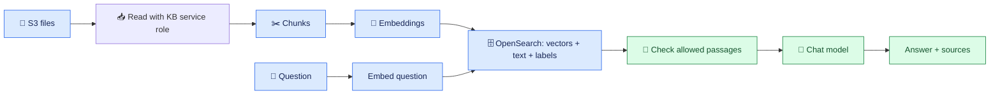

# 📚 Knowledge Bases: source files versus searchable content

## 🧩 Bedrock and RAG

- **Concept:** Amazon Bedrock provides access to models. Knowledge Bases prepares and retrieves document content.
- **Analogy:** a librarian creates a searchable catalogue and copies relevant passages for a writer.
- **AWS example:** a rollback runbook becomes chunks (small passages), then embeddings (number lists for comparison). Vector search finds passages related to a question; an LLM (large language model) writes an answer.
- **If misconfigured:** an unrelated or confidential passage can become answer evidence.
- **Takeaway:** retrieval chooses evidence; generation writes from it. Neither proves permission.

Preparation saves searchable records. Question-time retrieval uses those records.

## 🔑 Ingestion uses a different identity

- **Concept:** the Knowledge Base's service/execution role reads S3, rather than impersonating each engineer.
- **Analogy:** the librarian has a key to the archive that ordinary readers do not have.
- **AWS example:** the role reads both general and restricted prefixes and indexes them. Engineer A cannot download restricted S3 objects but may have permission to query the Knowledge Base.
- **If misconfigured:** a broad service role lets a data-source administrator ingest unintended prefixes.
- **Takeaway:** scope the service role to required data and treat ingestion management as privileged.

[AWS service-role guidance](https://docs.aws.amazon.com/bedrock/latest/userguide/kb-permissions.html)

## 🚨 Why restricted text can leak

- **Concept:** S3 object access and access to its indexed content are different requests.
- **Analogy:** locking the original file does not protect an unrestricted photocopy.
- **AWS example:** A's S3 request is denied, but an unfiltered Knowledge Base returns an already-indexed incident passage.
- **If misconfigured:** A receives confidential text through retrieval, citations, or the answer.
- **Takeaway:** denying A direct S3 access does not automatically remove A's access through the chatbot.

## 🗂️ Two Knowledge Base paths

| Path | What matters here |
| --- | --- |
| Standard configurable Knowledge Base | Our S3 + Titan + OpenSearch example; the application enforces document permissions |
| Bedrock Managed Knowledge Base | Bedrock manages the underlying search infrastructure; supported connectors offer optional ACL-aware filtering |

Do not infer Managed connector features from the word “managed” used informally.
The current API reference excludes Managed Knowledge Bases from
`RetrieveAndGenerate`; use their supported retrieval APIs.
[AWS Knowledge Base overview](https://docs.aws.amazon.com/bedrock/latest/userguide/knowledge-base.html) ·
[API distinction](https://docs.aws.amazon.com/bedrock/latest/APIReference/API_agent-runtime_RetrieveAndGenerate.html)

## 🎤 Interview FAQ

1. **What is an embedding?** A model-created number list used to compare text.
2. **Who reads S3 during ingestion?** The configured service role, not the querying engineer.
3. **Does S3 deny block indexed copies?** Not automatically; protect retrieval separately.
4. **What does the chat model receive?** Authorized passage text, question, and instructions—not just vectors.
