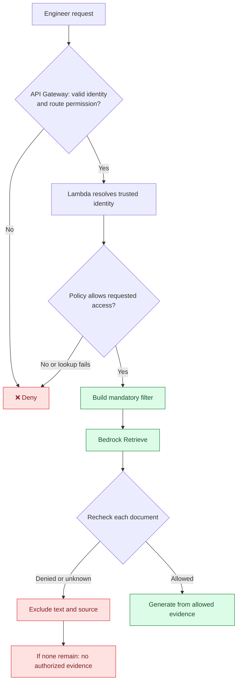

# 🛡️ Lambda: enforce the decision

## 🚪 The trusted entry point

- **Concept:** Lambda runs the application's checks between the engineer and Bedrock.
- **Analogy:** a security officer checks both the badge and the confidential-file permission.
- **AWS example:** API Gateway verifies a signed request; Lambda maps the trusted caller identity to current document permissions.
- **If misconfigured:** a client-supplied email, group, Knowledge Base ID, or filter could bypass restrictions.
- **Takeaway:** Lambda is useful because of the checks we implement. Simply placing it in the path provides no document protection.

For an IAM-protected route, requests must be signed with AWS Signature Version 4
and allowed to invoke the route. An SSO browser login is not itself an API request signature.
[AWS API Gateway IAM authorization](https://docs.aws.amazon.com/apigateway/latest/developerguide/http-api-access-control-iam.html)

Use verified API Gateway request context, not identity headers from the caller.
Resolve it through an administrator-controlled identity mapping. Do not assume a
shared role ARN exposes each human's groups. A browser chatbot needs a properly
authenticated backend or deliberately designed user-token flow; never embed permanent AWS keys.

## ✅ Allowed and denied paths

A gets general passages. B may also get restricted passages.
An ordinary search can return “no authorized evidence” without revealing that a confidential document exists.

## 🔎 Why check results before generation?

- **Concept:** pre-filter search, then compare returned document IDs against current permissions.
- **Analogy:** inspect the librarian's selected files before handing them to the writer.
- **AWS example:** a stale classification returns an incident chunk. Lambda checks its source ID against the current policy and excludes it.
- **If misconfigured:** checking after generation means the model already received unauthorized text.
- **Takeaway:** use **Retrieve → check → model call** for this design.

`RetrieveAndGenerate` combines these stages; it does not give Lambda an application
checkpoint between internal retrieval and generation.
[AWS retrieval operations](https://docs.aws.amazon.com/bedrock/latest/userguide/kb-how-retrieval.html)

Protect the backend too: unauthorized candidates must not leak through logs, debug responses, citations, or caches.

## 🚧 Prevent bypass

- Engineers may invoke the chatbot route, not protected Bedrock retrieval or OpenSearch directly.
- Restrict the backend role to approved Knowledge Bases and models.
- Restrict direct Lambda invocation, function URLs, role assumption, and policy changes.
- Keep upload/classification and ingestion administration separate from ordinary chat access.
- On policy errors, deny access; do not fall back to an unfiltered request.

## 🎤 Interview FAQ

1. **Why Lambda?** It is a convenient place to enforce trusted access decisions.
2. **Does API Gateway know each document's permissions?** Not through IAM route authorization alone.
3. **Why separate retrieval and generation?** To check results before any text reaches the model.
4. **What defeats a secure Lambda filter?** Another route that lets the same user retrieve unfiltered data.
