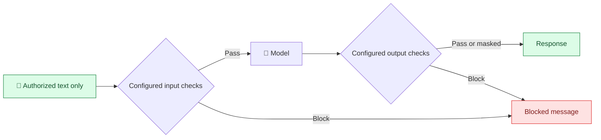

# 🔒 Guardrails: content checks, not file permissions

## 🧩 What they do

- **Concept:** Bedrock Guardrails checks configured content categories, such as denied topics or sensitive information.
- **Analogy:** a mail inspector checks what a letter contains; a file-access officer decides who may read the source file.
- **AWS example:** a configured sensitive-information filter blocks or masks detected personal information in a response.
- **If misconfigured:** an unconfigured category, unsupported content, or missed detection can pass through.
- **Takeaway:** configure and test the checks you need. They are not a universal secret detector.

A restricted incident report may contain no detectable personal information.
Guardrails cannot infer that Engineer A is forbidden from reading it.

## ⚖️ Different responsibilities

| Component | Purpose |
| --- | --- |
| IAM / SSO | Identity and AWS API access |
| ACLs / metadata filters | Document access rules and eligible search results |
| Lambda / Verified Permissions | Enforce access / decide whether it is allowed |
| Bedrock Guardrails | Additional input/output content protection |

## ⏱️ When checks happen

For supported model calls with Guardrails configured:

1. Input is evaluated against enabled policies; policy checks can run in parallel.
2. If blocked, Bedrock returns the configured blocked response and discards the model run.
3. Otherwise, the generated response is evaluated.
4. Output may pass, be blocked, or have detected sensitive information masked.

This does not mean arbitrary retrieval results are automatically sanitized.
[AWS Guardrails processing](https://docs.aws.amazon.com/bedrock/latest/userguide/guardrails-how.html)

This is the logical check sequence, not a claim that every policy inspects every input field.
Streaming behaviour needs separate review; this design assumes a checked, non-streamed response.

## 📚 Knowledge Base integration

- Standard `RetrieveAndGenerate` accepts a guardrail configuration during generation.
- AWS states its guardrails cover input and generated output, **not raw retrieved references**.
- Protect source snippets, citations, and downloads independently.
- In our split flow, configure Guardrails on the separate supported model call.
- A standalone `ApplyGuardrail` check can be used where appropriate; it still does not authorize documents.

[AWS Knowledge Base guardrail scope](https://docs.aws.amazon.com/bedrock/latest/userguide/kb-test-retrieve-generate.html)

## 🎯 Example: authorized but sensitive

B may read an incident report, but company policy prohibits returning a customer's
personal identifier. Document authorization allows the report; a configured content
check may mask the identifier. For A, block the report before the model sees it at all.

**Takeaway:** permission to read and permission to output a type of content are separate decisions.

## 🎤 Interview FAQ

1. **Can Guardrails replace IAM?** No; content checks do not grant or deny AWS resource access.
2. **Can they replace document ACLs?** No; they do not establish who may read each report.
3. **Are retrieved references automatically protected?** No; secure them separately.
4. **Does a passing guardrail prove correctness?** No; check evidence and generated claims too.
