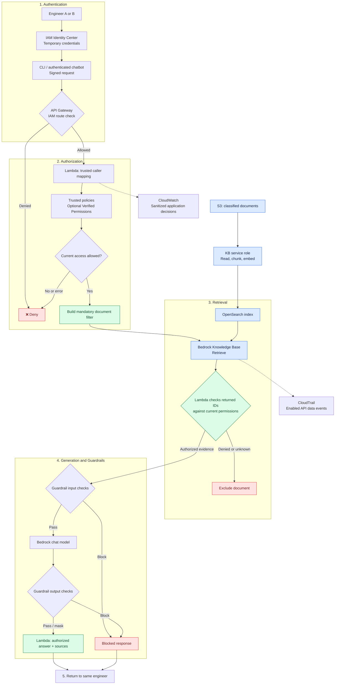

# 🏗️ Complete secure RAG design

## 🎯 Design and analogy

**Concept:** authenticate the engineer, authorize evidence, then generate a protected response.
**Analogy:** badge desk → file-access officer → librarian → writer → content review.
**AWS example:** B receives restricted incident evidence only after trusted permission checks.
**If misconfigured:** skipping any access path can expose text through answers, sources, or logs.
**Takeaway:** every path to document content needs the same permission boundary.

This diagram is a proposed standard Knowledge Base design, not deployed infrastructure.

If no authorized evidence remains, return a neutral “no authorized evidence” response.
Do not send excluded text to the model. Bind answers and conversation history to the same user and current permissions.

## 🧭 Identity handoffs

- API Gateway validates the signed caller and endpoint permission.
- Lambda resolves the individual user from trusted identity data.
- Lambda's role calls Bedrock; its broad service capability is narrowed by application checks.
- The Knowledge Base service role handles ingestion; it is not the engineer.
- Verified Permissions is optional; a small trusted policy mapping can illustrate the same decision.

See [Lambda details](04-lambda-and-security-flow.md) for bypass prevention and
[permissions](02-iam-sso-and-policies.md) for IAM limits.

## 🔄 Native ACL alternative

**Verified user → backend supplies verified user context → Managed Knowledge Base
ACL-aware retrieval → approved evidence → model and Guardrails → response.**

Like a librarian with access lists, this reduces custom filtering work but still
requires trustworthy identity and a protected backend. S3/Custom have no live
permission recheck; see [connector differences](03-document-level-authorization.md).
Do not reuse standard `RetrieveAndGenerate` assumptions for Managed Knowledge Bases.

## 🔍 Monitoring without creating another leak

- **Concept:** record who requested what and why it was allowed, without copying sensitive passages.
- **Analogy:** the checkout log records the reader and file number, not every confidential page.
- **AWS example:** CloudWatch stores protected request IDs, policy decisions, document IDs, and errors. CloudTrail records enabled AWS API events.
- **If misconfigured:** raw prompts, snippets, or answers in broadly readable logs create a second leak.
- **Takeaway:** restrict log access and retention; use sanitized audit evidence.

Knowledge Base retrieval data events are not logged by default. Configure the
appropriate CloudTrail selectors. Service-role events alone may not identify the
human; correlate with the backend's protected user/request record.
[AWS CloudTrail guidance](https://docs.aws.amazon.com/bedrock/latest/userguide/logging-using-cloudtrail.html)

## ✅ Checks to explain in an interview

| Scenario | Expected result |
| --- | --- |
| A asks a general question | General evidence only |
| A requests a restricted report | No restricted text, title, citation, or download |
| B requests an allowed restricted report | Authorized evidence and supported answer |
| A changes email, filter, or Knowledge Base ID | Ignored or denied |
| Permission service fails / document label missing | Deny affected content |
| B's access is revoked | Restricted retrieval, cached answers, and old context blocked |
| A calls Bedrock/OpenSearch directly | Access denied |

These are proposed checks, not completed test results.

## 🎤 Interview FAQ

1. **Where is the main authorization check?** Before retrieval, with a result check before generation.
2. **Why not just hide citations?** The answer could still disclose the content.
3. **Does CloudTrail replace application audit records?** No; service calls may show the backend role rather than the person.
4. **What is a secure failure?** Deny affected access instead of removing filters and retrying.
